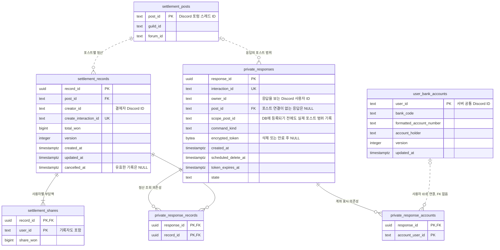

# Discord 포럼 정산 구현 명세

[기능 의도](../intent/정산기능-intent.md)의 동작을 Node.js·TypeScript Discord 봇, 정산 봇 전용 PostgreSQL, Graphile Worker로 구현한다. 정산 포스트는 Discord 스레드 ID로 식별하고 정산 기록·배분·계좌는 PostgreSQL에 저장한다.

## 1. Discord 입력과 권한

| 진입점 | 처리 |
| --- | --- |
| `/정산` | 포럼 포스트 안에서 모달을 연다. User Select로 참여자를 선택하고 Text Input으로 원화 총액을 입력한다. 제출을 비공개로 승인한 뒤 저장한다. 완료 응답에 이번 기록에서 작성자가 받을 금액을 참여자별로 보여준다. |
| `/정산확인` | 같은 포스트의 내 송금액을 수신자별로 묶어 조회한다. 등록된 최신 계좌가 있는 수신자만 금액 바로 아래에 계좌 코드 블록을 붙인다. |
| `/정산세부` | 내가 기록자이거나 참여자인 기록을 최신순으로 조회한다. 한 페이지에 기록 한 건을 보여준다. 내 기록에만 `수정`·`취소` 버튼을 붙인다. |
| `수정`·`취소` | 수정은 기존 참여자와 총액을 채운 모달을 연다. 취소는 비공개 확인 버튼을 한 번 더 누르면 확정한다. 모달과 버튼 처리 때마다 포스트·기록자·기록 버전을 다시 검사한다. |
| `/계좌등록` | 명령 옵션 없이 폼을 연다. 국내 은행 하나를 고르고 계좌번호와 예금주명을 입력하면 계좌를 등록하거나 교체한다. 오류 시 비공개 설명과 재입력 버튼을 제공한다. |
| `/계좌삭제` | 본인 계좌 삭제를 비공개로 확인받고 적용한다. 계좌가 이미 없어도 같은 결과를 반환한다. |

- 정산 명령은 현재 채널이 공개 스레드이고 부모 채널이 `GUILD_FORUM`일 때 허용한다. ID는 인터랙션의 채널에서 결정한다. 일반 채널·일반 채널 스레드·미디어 채널·DM에서 받은 정산 명령에는 사용 위치를 비공개로 안내한다. 계좌 명령은 봇이 설치된 서버에서 포스트 밖에서도 쓸 수 있다.
- 폼 제출자와 버튼 사용자는 Discord 인터랙션에서 읽는다. 원래 포스트나 결과를 열었던 사용자와 일치하는지 서버에서 검증한다. 대상 기록 ID·페이지 번호·버전을 전달하는 버튼 값에는 계좌번호와 응답 토큰을 넣지 않는다. 대상 기록의 소유권은 DB에서 확인한다.
- 현재 서버의 사람 계정만 받는다. 선택 목록의 중복과 기록자 ID를 정리한 뒤 다른 참여자가 최소 한 명 남아야 한다. 모달의 Discord 사용자 선택은 최대 25명으로 제한한다. 기록자는 계산 시 한 번만 추가한다.
- 개인 계좌를 등록할 수 있는 국내 은행 19곳을 표시한다. IBK경제연구소의 주거래은행 조사에 나온 9개를 조사 순서대로 먼저 표시하고 나머지 10개는 이름순으로 표시한다. 한국수출입은행은 개인 정산용 선택 목록에서 제외한다. [한국은행 국내 은행 목록](https://www.bok.or.kr/portal/main/contents.do?menuNo=200580) · [2026 개인금융 인사이트 보고서, 7쪽](https://research.ibk.co.kr/fup/support/institute/about/finance/2026031616371429459317707366478.pdf#page=7)
- 일반 메시지 감지와 공개 댓글 생성은 사용하지 않는다. 초기 인터랙션은 Discord 제한 시간인 3초 안에 모달 표시, 비공개 응답 또는 비공개 승인으로 처리한다. 필요한 모달 응답은 먼저 승인하는 대신 즉시 모달을 연다.
- 설치는 Discord 앱 설치 링크를 사용한다. 명령 등록에는 `applications.commands`를 사용하고 앱 실행에는 봇 설치와 Gateway 연결을 유지한다. 일반 본문 조회를 제거하므로 이 기능에는 `MessageContent` 인텐트가 필요하지 않다.

공식 문서 [포럼 채널 유형](https://docs.discord.com/developers/resources/channel#channel-types) · [User Select](https://docs.discord.com/developers/components/reference#user-select) · [인터랙션 응답](https://docs.discord.com/developers/interactions/receiving-and-responding)

## 2. 데이터 모델

Discord ID는 문자열로 다룬다. 포스트가 정산 기록 여러 건을 가지므로, 포스트 ID는 포스트 테이블의 PK이자 정산 기록의 FK로 쓰고 각 기록에는 별도 PK를 부여한다.

다모아와 같이 공용 `pg.Pool`을 `PrismaPg`에 연결한다. 업무 쿼리는 Prisma 모델로 작성하고 Graphile 작업 등록은 마이그레이션의 PostgreSQL 트리거가 처리한다. 명령별 쿼리와 실행 순서, 트랜잭션 범위는 [SQL 설계](정산기능-sql.md)를 참고한다.

### ERD



- **송금액의 수신자**는 `settlement_records.creator_id`이고, **송금액의 발신자와 금액**은 `settlement_shares.user_id`, `share_won`에서 읽는다. 한 기록의 부담액은 기록자 몫을 포함해 최소 두 줄이다. 정산 저장 트랜잭션 안에서 부담액 합계를 검증하고 기록자 자신의 몫은 송금 조회에서 뺀다.
- **계좌 의존성**은 계좌 행의 존재와 관계없이 수신자의 Discord ID로 남긴다. 따라서 계좌가 없는 상태에서 답장을 보낸 경우에도 첫 등록 시 그 답장을 찾을 수 있고, 계좌를 삭제할 때도 의존성이 사라지지 않는다.
- **응답의 포스트 연결**은 응답이 정산 기록을 참조할 때 사용한다. 기록을 표시하지 않는 빈 조회 및 포스트 밖 계좌 등록 응답은 이 FK를 비워둔다. 포스트 안의 조회는 `scope_post_id`로 실제 포스트 범위를 저장한다.
- **삭제 작업**은 Graphile Worker가 관리한다. 애플리케이션 테이블과 연결하는 FK는 두지 않고, 작업 payload의 `response_id`로 `private_responses`를 찾는다. 한 비공개 응답의 기본 예약과 즉시 삭제 요청은 같은 작업 키를 사용한다.

| 테이블 | 주요 필드와 제약 |
| --- | --- |
| `settlement_posts` | `post_id` PK, `guild_id`, `forum_id`. 첫 정산 저장 시 생성한다. |
| `settlement_records` | `record_id` PK, `post_id` FK, `creator_id`, `total_won` 양의 정수, `version`, `created_at`, `updated_at`, `cancelled_at`. 생성 제출의 Discord 인터랙션 ID에 유니크 제약을 둔다. |
| `settlement_shares` | `(record_id, user_id)` 복합 PK, `share_won` 0 이상의 정수. 기록자 몫을 포함해 저장한다. |
| `user_bank_accounts` | `user_id` PK, 은행 코드, 표시용 계좌번호, 예금주명, 갱신 시각·버전. 서버별 컬럼 없이 사용자 ID로 연결한다. 삭제 시 계좌 정보는 지운다. |
| `private_responses` | 내부 응답 ID, 소유자 ID, 명령 종류, 포스트 ID, 암호화된 원본 인터랙션 토큰, 생성·예약 삭제·토큰 만료 시각, 처리 상태. Discord 원본 인터랙션 ID는 유일하다. |
| `private_response_accounts`, `private_response_records` | 응답 ID와 관련 계좌 소유자 ID 또는 기록 ID의 연결. `/정산확인`의 대상 수신자는 계좌 미등록 상태에서도 연결해 추후 등록 시 무효화할 수 있게 한다. |

- 상세 조회를 위해 `settlement_records(post_id, created_at DESC, record_id DESC)`와 `settlement_shares(user_id, record_id)`에 인덱스를 둔다. 무효화는 계좌 소유자, 기록 ID, 포스트·응답 소유자 조합으로 인덱싱한다.
- 생성·수정은 기록과 배분 저장을 한 트랜잭션으로 처리한다. 수정·취소는 현재 버전에 조건을 걸어 오래 열린 화면으로 이후 변경을 덮지 않게 한다. 저장 충돌 시 사용자가 상세를 다시 열도록 비공개로 안내한다.
- 합계와 페이지는 트랜잭션 내 일관된 조회 결과로 만들고, 취소된 기록을 제외한다. Discord 전송은 DB 트랜잭션 밖에서 실행한다.

## 3. 정산, 계좌, 표시

1. **총액 파싱** — 양끝 공백을 제거하고 숫자 또는 올바른 천 단위 쉼표 형식에 선택적인 `원` 접미사 하나를 허용한다. 쉼표와 접미사를 제거해 `bigint`로 읽는다. 1~15자리 양의 원화 정수를 받고, 소수·부호·임의 문자·잘못된 쉼표는 오류로 처리한다. 합계도 정수로 다룬다.
2. **배분** — `T / N`의 정수 몫을 모두에게 주고, `T % N`명에게 1원씩 더한다. 기록자를 포함한 참여자 중 중복 없이 균등하게 추첨하고 결과를 한 번 저장한다. 총액과 정규화한 참여자 집합이 모두 같으면 배분과 버전을 유지한다. 값이 바뀌면 새로 계산한다. 0원 몫은 저장할 수 있고 송금 항목에서는 숨긴다.
3. **합계** — 내 몫이 있고 수신자가 나 자신이 아닌 유효한 기록을 찾는다. 현재 포스트 안에서 기록자 ID별로 내 몫을 합산하고, 수신자의 최신 계좌를 연결한다. 예시의 `A → B: 5,000원` 아래에 다음 블록을 붙인다. 계좌가 없으면 블록 전체를 생략한다. 멘션으로 이름을 표시하더라도 실제 알림은 비활성화한다.

   ```text
   토스뱅크 1000-1234-5678 홍길동
   ```

4. **상세** — `ORDER BY created_at DESC, record_id DESC LIMIT 1 OFFSET (page - 1)`로 유효한 기록을 가져온다. 기록자라면 내게 보내는 사람의 항목을, 부담자라면 기록자에게 내가 보낼 항목을 보여준다. 같은 기록의 다른 사람끼리 주고받을 금액은 숨긴다. 페이지 버튼은 누를 때마다 현재 DB를 읽고, 취소로 마지막 페이지가 사라지면 남은 마지막 페이지를 보여준다. 같은 비공개 답장의 내용과 버튼을 수정하며 최초 답장을 생성한 시점의 14분 삭제 예약을 유지한다.
5. **응답 길이** — 합계가 Discord 메시지 제한을 넘으면 수신자 단위로 나누어 비공개 페이지로 제공한다. 각 페이지에서 금액과 계좌 블록을 붙여 유지한다. 합계의 다른 페이지를 요청하면 새 비공개 응답을 만들고 앞서 열려 있던 페이지는 삭제 작업으로 넘긴다. 코드 블록 문법을 깨는 예금주명의 문자는 표시 단계에서 처리한다.
6. **계좌 정규화** — 다모아 Backend의 지원 은행 목록, 은행별 포맷과 예금주 정규화를 재사용한다. 계좌번호의 공백·하이픈을 제거한 뒤 숫자 1~16자리인지 검증한다. 해당 은행에서 확인된 형식이면 하이픈을 적용하고, 형식을 결정할 수 없는 유효한 입력은 다모아와 같이 숫자만 표시한다. 예금주명은 NFC 정규화·공백 정리 후 길이와 제어 문자를 검사한다. 실제 계좌 존재 여부나 예금주 실명 확인은 제공하지 않는다. 잘못된 입력은 저장하지 않고 폼을 다시 열 수 있게 안내한다.

참조 [다모아 계좌번호 포맷](https://github.com/Da-Moa/Backend/blob/main/src/shared/domain/user/bankAccount.ts#L111) · [다모아 입력 정규화](https://github.com/Da-Moa/Backend/blob/main/src/shared/domain/user/bankAccount.ts#L193)

## 4. 워커와 비공개 응답 삭제

다모아처럼 도메인 변경과 Graphile 작업 등록을 같은 PostgreSQL 트랜잭션에서 처리한다. 이 구현에서는 Prisma가 비공개 답장을 만들거나 상태를 무효화하고, DB 트리거가 Graphile 작업을 등록한다. 워커는 Discord 응답 삭제 API를 호출하는 작업을 맡는다. 여기서 즉시 삭제는 작업의 예약 시간을 현재로 당겨 완료된 트랜잭션부터 실행 가능하게 한다는 뜻이다.

1. **응답 생성** — 명령, 모달 제출, 버튼에서 비공개 답장을 만들 때 공통 응답 처리를 거친다. 비공개 원본 응답을 승인한 뒤 응답 메타데이터·의존 관계 저장과 `delete_private_response` 작업 추가를 같은 트랜잭션에서 수행한다. 오류 안내와 계좌 관리 응답도 14분 삭제 대상으로 등록한다. 안내에 조회 데이터가 없다면 의존 관계 없이 저장한다. `run_at`은 비공개 원본 응답 생성 시각 + 14분이다. 토큰의 실제 만료는 해당 인터랙션 수신 기준 15분으로 별도 기록한다. 커밋 후 원본 응답에 내용을 채운다. 삭제 예약을 저장할 수 없다면 정산 결과나 계좌 정보를 응답에 채우지 않는다.
2. **즉시 삭제** — 계좌의 실질 변경·삭제·최초 등록 시 계좌에 연결된 응답을 서버 경계 없이 찾는다. 기록의 실질 수정·취소 시 해당 기록을 보여 준 응답과 같은 포스트에서 영향을 받는 조회·상세 목록 응답을 찾는다. 수정 전과 후의 참여자를 모두 고려한다. 대상 응답을 무효로 표시하고 동일한 작업 키로 `run_at = now()`를 등록하는 것을 도메인 변경과 함께 커밋한다. 값이 같아 변경이 없으면 큐를 건드리지 않는다. 같은 사람이 같은 포스트에서 같은 종류의 조회를 다시 열면 새 결과 게시가 성공한 후 기존 조회 답장도 이 방식으로 삭제를 요청한다.
3. **예약 대체** — 응답마다 `private-reply:<응답 ID>`를 작업 키로 사용한다. `graphile_worker.add_job`의 `replace`로 대기 중인 14분 예약을 즉시 작업으로 교체하므로 향후 실행될 일반 예약이 남지 않는다. 기존 작업이 이미 잠겨 실행 중이면 새 작업도 생길 수 있으므로 작업 키만으로 정확히 한 번 호출된다고 가정하지 않는다.
4. **중복과 만료** — 워커는 응답 행의 상태와 토큰 만료를 확인한 뒤 Discord 원본 응답 삭제 API를 호출한다. 성공 및 이미 없는 응답은 동일하게 종료하고 토큰을 지운다. 실행이 겹쳐도 상태가 되돌아가지 않게 한다. 일시 장애는 남은 유효 시간 안에서 재시도하고, 토큰이 만료되면 Discord에 더 요청하지 않고 종료한다. 만료되어 삭제가 불가능한 화면은 다음 명령을 실행할 때 최신 내용을 새로 보여 준다.
5. **조회와 갱신이 동시에 일어날 때** — 응답에 사용할 데이터를 읽고 의존성을 저장하는 트랜잭션과 해당 데이터를 변경하고 응답을 무효화하는 트랜잭션에 `SERIALIZABLE`을 적용한다. 충돌은 트랜잭션 전체를 제한적으로 재시도한다. 정산 수정·취소는 소유자와 버전으로 적용 여부를 확인한다. 포스트·계좌 advisory lock과 선행 `SELECT FOR UPDATE`는 사용하지 않는다. 결과 게시 직전 응답 유효 상태를 확인하고, 이미 삭제된 Discord 원본은 재생성하지 않는다.
6. **응답 자격 정보** — 토큰은 큐에 복사하지 않고 제한된 DB 영역에 암호화해 저장한다. 큐 페이로드에는 응답 ID만 넣는다. Discord 응답 삭제 URL에도 토큰이 포함되므로 토큰·요청 URL·계좌번호를 로그에 기록하지 않는다. 정상 종료뿐 아니라 만료된 응답과 토큰이 작업 실패 후에도 남지 않도록 만료 정리 작업을 둔다.

참조 [다모아의 트랜잭션 내 작업 등록](https://github.com/Da-Moa/Backend/blob/main/src/backend/domain/settle/repository/settle.repository.ts#L1119) · [다모아의 작업 실행기](https://github.com/Da-Moa/Backend/blob/main/src/backend/domain/settle/service/receiptWorker.ts#L143) · [Graphile 작업 키와 실행 중 교체](https://worker.graphile.org/docs/job-key) · [Discord 원본 응답 삭제](https://docs.discord.com/developers/interactions/receiving-and-responding#delete-original-interaction-response)

## 5. 구현 순서와 검증

1. 기존 봇 명령·크론·웹·OAuth와 해당 의존성·설정·테스트, Docker와 CD의 웹 포트 전달을 정리한다. 기존 Docker 빌드 및 CI 구조를 바탕으로 봇과 DB를 시작할 수 있게 구성한다.
2. PostgreSQL 마이그레이션과 배분 계산을 작성한다. 명령별 인터랙션 처리, 계좌 포맷, 합계·상세 조회, 소유자 수정·취소를 붙인다. Discord SDK가 모달의 User Select와 응답 파싱을 지원하는지 의존성 갱신 단계에서 확인한다.
3. Graphile Worker 스키마 마이그레이션 후 작업 등록·실행·만료 정리를 붙인다. 정산 결과 삭제는 재시작 시에도 예약이 살아 있는지 확인한다.

| 검증 | 주요 사례 |
| --- | --- |
| 계산·정규화 단위 테스트 | 쉼표와 원 표시, 잘못된 입력, 2원 이상 나머지, 작성자의 추첨 포함, 합계 보존, 변경 없는 수정, 은행별 하이픈과 숫자 표기, 예금주 입력 오류 |
| PostgreSQL 통합 테스트 | 한 포스트의 복수 기록, 포스트·서버 간 정산 차단, 권한 없는 수정·취소 거절, 수신자별 합계와 상세 필터, 동일 제출 중복 방지, 서버 공통 계좌 갱신, 두 풀 커넥션을 이용한 계좌 최초 등록·정산 변경과 조회의 경합 및 재시도 |
| 워커 통합 테스트 | 14분 예약, 무효화 시 예약의 즉시 작업 전환, 실행 중 경합, 작업 재실행과 Discord 404, 만료, 재시작, 토큰 정리, 관련 없는 응답 유지 |
| Discord 테스트 서버 | 사용자 직접 생성 포스트, 명령·모달·버튼 흐름, 다른 참여자의 비공개 조회, 잘못된 양식 비공개 안내, 공개 댓글 없음, 계좌 표시와 갱신 후 응답 삭제 |
